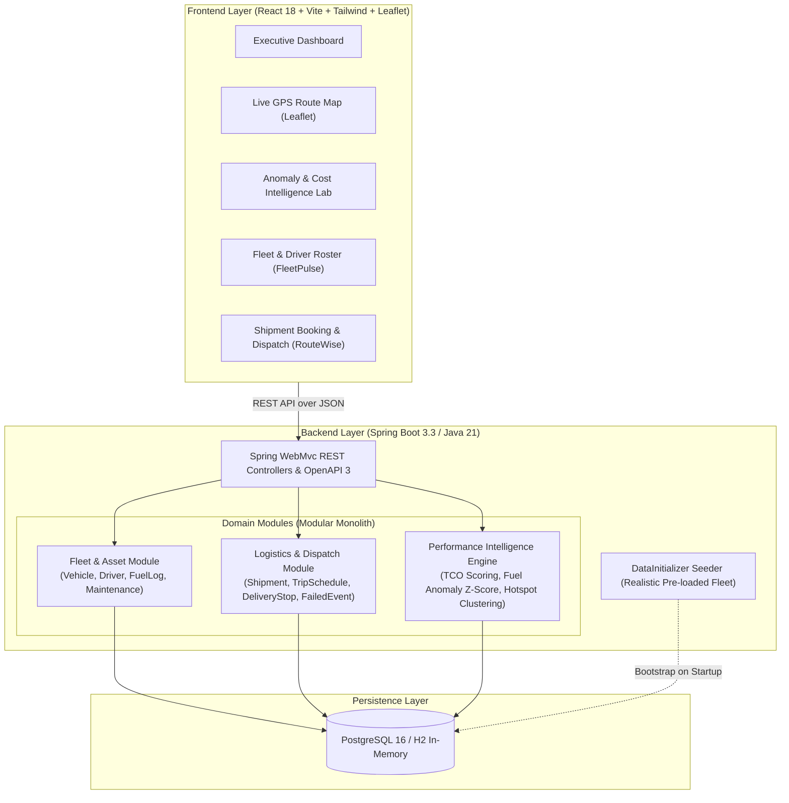
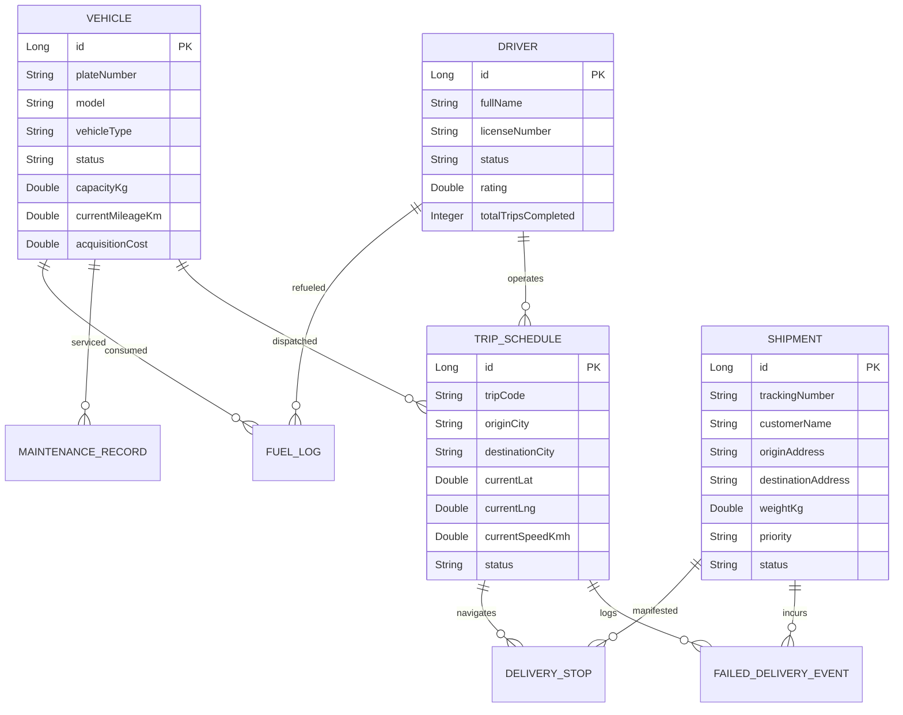

# 🚚 Horizon Fleet & Logistics Operations Suite

[](https://www.oracle.com/java/)
[](https://spring.io/projects/spring-boot)
[](https://www.postgresql.org/)
[](https://react.dev/)
[](https://leafletjs.com/)
[](https://www.docker.com/)
[](LICENSE)

An enterprise-grade, end-to-end transportation and delivery management platform that merges **FleetPulse** (Vehicle & Asset Management), **RouteWise** (Logistics & Dispatch Operations), and **Logistics Performance Intelligence** (Automated Cost & Anomaly Analytics).

---

## 📌 Executive Overview

Modern logistics operators suffer from fragmented tools: one app for vehicle maintenance, another for dispatch, third-party spreadsheets for fuel receipts, and disconnected telematics. 

**Horizon Fleet & Logistics Operations Suite** unifies the entire lifecycle into a single operational cockpit:
1. **Asset & Driver Governance**: Track vehicle lifecycles, odometer readings, and driver rosters with safety scores.
2. **Order Intake & Multi-Stop Dispatch**: Book shipments, optimize delivery routes, and ingest real-time GPS telemetry.
3. **Interactive Geospatial Tracking**: Visualize active freight runs on an interactive Leaflet map with speed, delay, and waypoint popups.
4. **Maintenance & Fuel Expense Ledger**: Log servicing records and per-stop fuel refuels with efficiency calculations ($km/L$).
5. **Standout Feature — Performance & Anomaly Intelligence**:
   - 🚨 **Unusual Fuel Consumption Detection**: Identifies drivers whose fuel burn significantly exceeds the vehicle model's baseline benchmark (e.g. flagging aggressive acceleration, excessive idling, or siphon risks).
   - 💰 **Expensive Vehicle Ranking**: Calculates Total Cost of Ownership (TCO) and cost-per-kilometer across fuel and maintenance to flag high-depreciation assets.
   - 📉 **Corridor Bottleneck Analytics**: Analyzes corridor delay frequencies, average delay durations, and delivery reliability grades.
   - 📍 **Recurring Delay Hotspots**: Clusters geolocations with persistent delivery failures and access friction.

---

## 🏗️ System Architecture



---

## 📊 Domain Entity Model



---

## 🚀 Key Modules & Capabilities

### 1. Fleet & Vehicle Management (`FleetPulse`)
* **Vehicle Directory**: Filter by category (Heavy Truck, Delivery Van, Refrigerated Reefer, Flatbed Trailer) and operational status (`AVAILABLE`, `IN_TRANSIT`, `MAINTENANCE`).
* **Driver Roster & Pairing**: Duty cycle tracking (`ON_DUTY`, `AVAILABLE`, `OFF_DUTY`), safety star ratings, and 1-click vehicle assignment.
* **Maintenance Scheduler**: Preventive servicing alarms, mileage countdowns, and component overhaul expense tracking.

### 2. Logistics & Delivery Operations (`RouteWise`)
* **Shipment Manifests**: Cargo booking with auto-generated tracking numbers, weight validations, and priority tiers (`CRITICAL`, `EXPRESS`, `STANDARD`).
* **Live GPS Route Tracking**: OpenStreetMap Leaflet integration rendering active trucks on interstate corridors, speed telemetry, and route lines.
* **Delivery Stops & Waypoints**: Sequence indexes, pickup/dropoff confirmations, and real-time delay reasons.

### 3. Standout Feature: Anomaly & Cost Intelligence Engine
* **Fuel Overconsumption Detection**: 
  $$\Delta \% = \left(\frac{\text{Benchmark km/L} - \text{Observed km/L}}{\text{Benchmark km/L}}\right) \times 100$$
  Flags drivers exceeding variance thresholds, generates root-cause hypotheses (e.g. prolonged engine idling, aggressive throttle habits, siphon leak risk), and suggests actionable interventions.
* **Total Cost of Ownership (TCO) Vehicle Ranking**: Ranks every vehicle in the fleet by aggregated fuel expenditure, maintenance repair bills, and cost-per-kilometer.
* **Corridor Bottleneck Analysis**: Identifies highway routes with recurring delay patterns, on-time percentage drop-offs, and average minutes lost.
* **Delay Hotspots Clustering**: Clusters geolocations that suffer frequent failed deliveries or gate congestion (e.g. port terminals, unstaffed commercial docks).

---

## 🛠️ Tech Stack

| Layer | Technologies |
|---|---|
| **Backend Framework** | Java 21, Spring Boot 3.3.4, Spring Data JPA, Spring Validation |
| **API & Documentation** | RESTful JSON, Springdoc OpenAPI 3.0 / Swagger UI |
| **Databases** | PostgreSQL 16 (Production), H2 In-Memory (Zero-setup Dev) |
| **Frontend Framework** | React 18, Vite 5, Tailwind CSS, Lucide Icons |
| **Mapping & Geospatial** | Leaflet 1.9, React-Leaflet |
| **Containerization** | Docker, Docker Compose, Multi-stage alpine builds |

---

## 📡 REST API Reference

The backend includes auto-generated OpenAPI documentation accessible at:
👉 `http://localhost:8080/swagger-ui.html`

### Fleet Endpoints
| Method | Endpoint | Description |
|---|---|---|
| `GET` | `/api/v1/fleet/vehicles` | List all registered fleet vehicles |
| `POST` | `/api/v1/fleet/vehicles` | Register a new vehicle asset |
| `PATCH` | `/api/v1/fleet/vehicles/{id}/status` | Update operational status (`AVAILABLE`, `IN_TRANSIT`, `MAINTENANCE`) |
| `GET` | `/api/v1/fleet/drivers` | List all drivers and duty statuses |
| `POST` | `/api/v1/fleet/drivers/{driverId}/assign-vehicle/{vehicleId}` | Assign vehicle to driver |
| `GET` | `/api/v1/fleet/fuel-logs` | Retrieve fuel expense ledger |
| `GET` | `/api/v1/fleet/maintenance` | Retrieve preventive maintenance records |

### Logistics & Route Endpoints
| Method | Endpoint | Description |
|---|---|---|
| `GET` | `/api/v1/logistics/shipments` | List freight shipments |
| `POST` | `/api/v1/logistics/shipments` | Book a new customer shipment |
| `GET` | `/api/v1/logistics/trips/active` | Get active transit runs with GPS coordinates and speeds |
| `PATCH` | `/api/v1/logistics/trips/{id}/telemetry` | Ingest real-time GPS coordinates and speed |
| `GET` | `/api/v1/logistics/failed-deliveries` | Retrieve delivery exceptions and failed attempts |
| `POST` | `/api/v1/logistics/failed-deliveries/{id}/retry` | Schedule an immediate redelivery dispatch |

### Intelligence & Anomaly Endpoints
| Method | Endpoint | Description |
|---|---|---|
| `GET` | `/api/v1/analytics/overview` | Executive KPI summary (Fleet count, on-time rate %, fuel spend) |
| `GET` | `/api/v1/analytics/vehicles/cost-ranking` | Rank vehicles by Total Cost of Ownership and cost/km |
| `GET` | `/api/v1/analytics/fuel/anomalies` | Detect drivers with unusual fuel consumption vs benchmark |
| `GET` | `/api/v1/analytics/routes/efficiency` | Corridor reliability and bottleneck grading |
| `GET` | `/api/v1/analytics/delay-hotspots` | Clustered delay/failure geographic hotspots |

---

## ⚡ Quickstart & Installation

### Option 1: Docker Compose (Recommended - Single Command)

Ensure Docker and Docker Compose are installed, then run:

```bash
docker-compose up --build
```

* **Frontend Dashboard**: `http://localhost:3000`
* **Backend API**: `http://localhost:8080`
* **Swagger API Docs**: `http://localhost:8080/swagger-ui.html`
* **PostgreSQL Database**: `localhost:5432`

---

### Option 2: Running Locally for Development

#### 1. Backend (Spring Boot 3.3 + Java 21)
The backend uses H2 in-memory mode by default with pre-seeded data, requiring zero external database configuration:

```bash
cd backend
mvn clean spring-boot:run
```
The backend starts on port `8080`.

#### 2. Frontend (React + Vite)
In a separate terminal:

```bash
cd frontend
npm install
npm run dev
```
The frontend starts on `http://localhost:3000` with automated proxying to the Spring Boot backend.

---

## 👨‍💻 Author

**Prasun Nandi**
* GitHub: [@Prasunnandi](https://github.com/Prasunnandi)
* Repository: [fleet-logistics-operations-suite](https://github.com/Prasunnandi/fleet-logistics-operations-suite)

---

## 📄 License

This project is licensed under the [MIT License](LICENSE).
